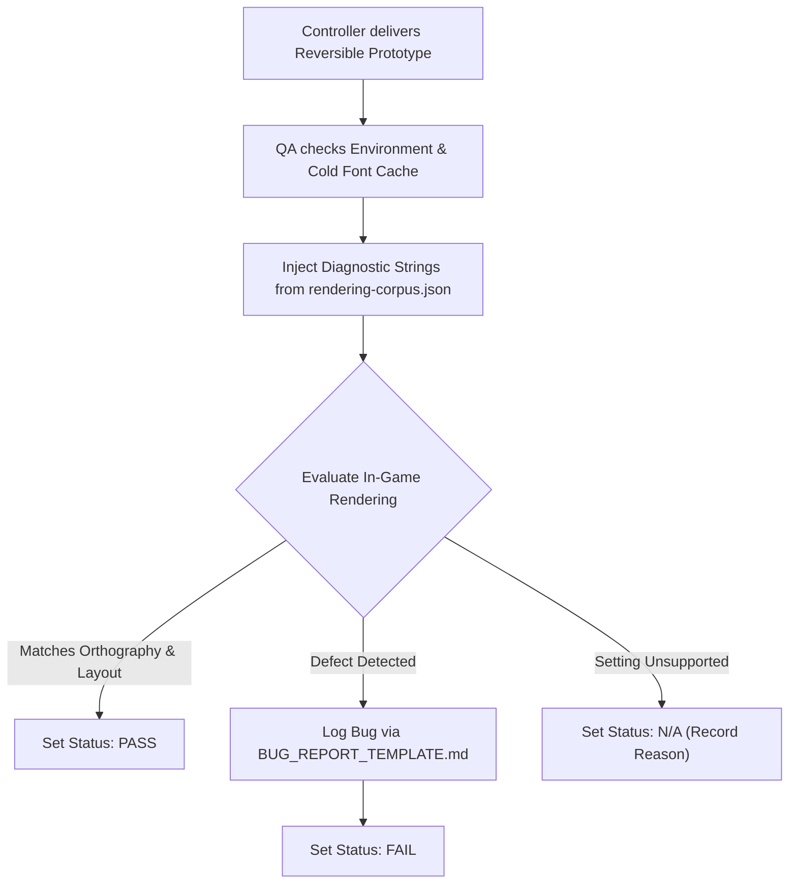

# Two Point Campus Thai Mod — QA Test Matrix

> **Author:** Antigravity (QA Agent)  
> **Reviewer / Controller:** ChatGPT  
> **Date:** 2026-10-15  
> **Status:** PROVISIONAL TEST PLAN — ALL RUNTIME TEST CASES SET TO `NOT_RUN`  
> **Disclaimer:** All test strings referenced herein from [rendering-corpus.json](file:///d:/SteamLibrary/steamapps/common/Two%20Point%20Campus/ThaiCampusMod/docs/qa/rendering-corpus.json) are synthetic rendering data generated solely for font, shaping, and UI verification. They do **not** represent extracted Two Point Campus strings, official dialogue, or approved translations.

---

## 1. Technical Baseline & Verified Evidence

Based on [reports/initial-inspection.json](file:///d:/SteamLibrary/steamapps/common/Two%20Point%20Campus/ThaiCampusMod/reports/initial-inspection.json) and Controller review:

1. **Campus Engine & Inventory:**
   - Campus executable build is `10.3.169253+2024-12-06.1241` running on Unity `2020.3.47f1` (IL2CPP).
   - The initial inspected Addressables catalog did **not** reveal explicit Thai-named references (e.g. `NotoSans_Thai` or `Localisations/Thai`). *Note: This is an inventory finding from the primary base catalog, not a complete glyph-coverage, fallback chain, embedded-resource, or DLC audit.*
   - `catalog_relevant_ids` contains filtered internal resource IDs, while `catalog_keys` stores catalog JSON property names. Neither constitutes verified runtime behavior.
2. **Museum Comparison:**
   - Two Point Museum runs on Unity `6000.0.63f1` (Unity 6).
   - Although Museum catalog references `NotoSans_Thai.asset`, `NotoSansThai-Medium.ttf`, and `I2LS_Fonts.txt`, these represent inventory evidence only. Font naming does not prove runtime shaping, OpenType support, or line-breaking capabilities. Direct bundle porting across major Unity versions (2020.3 vs 6) remains unverified.
3. **Runtime Unknowns (Pending In-Game Testing):**
   - TextMeshPro (TMP) complex script shaping: Whether the runtime FontEngine utilizes HarfBuzz / GPOS / GSUB tables or produces floating tone marks and unhandled descender collisions.
   - Line breaking: Whether the engine contains a Thai dictionary breaker, or requires explicit Zero-Width Space (`\u200B`) injection in prototype experiments.
   - Supported settings: In-game UI scale options, resolution support, and variable formatting grammar remain candidate syntax until confirmed in a running prototype.

---

## 2. Test Execution Protocol

*   **Status Codes:**
    *   `NOT_RUN`: Test defined; waiting for reversible engineering prototype.
    *   `PASS`: Rendered output strictly matches standard Thai typography and UI layout.
    *   `FAIL`: Visual or functional defect detected; bug report filed.
    *   `BLOCKED`: Cannot be evaluated due to prerequisite failure or missing prototype feature.
    *   `N/A`: Option not supported by the game engine (e.g. unsupported UI scale value, reason recorded).
*   **Dynamic Font Validation Protocol:**
    *   For runtime dynamic font generation, tests must be evaluated after a **cold restart** (clean font atlas cache) and re-checked after **navigating across multiple distinct UI screens** to detect dynamic atlas exhaustion or missing glyph allocations.
*   **Severity Assignment Policy:**
    *   Severity is determined strictly by **gameplay and reading impact**, not visual defect category. Unreadable text or loss of essential information is classified as `Major` or `Critical`, regardless of whether the visual cause is a tone mark or clipping.

---

## 3. Test Matrix Table

| Case ID | Category | Corpus ID | Description & Target Elements | Input String / Diagnostic Sequence | Expected Orthographic / Layout Behavior | Status |
| :--- | :--- | :--- | :--- | :--- | :--- | :--- |
| **TM-VOWEL-01** | Upper Vowels (Neutral) | `CRP-VOWEL-01` | Standard upper vowels (`ิ`, `ี`, `ึ`, `ื`, `ั`, `็`) with standard consonants | `กินดี มีตึก ฝึกฝน ยืมหนังสือ ตัดต้นไม้ เป็ดเดิน` | Upper vowels render at level 1 above consonant baseline without vertical clipping. | `NOT_RUN` |
| **TM-VOWEL-02** | Upper Vowels (Ascenders) | `CRP-VOWEL-02` | Upper vowels with tall ascender consonants (`ป`, `ฝ`, `ฟ`) | `ปิกนิก ปีนี้ ปึกแผ่น ปืนโต ฝีมือ ฟิตเนส ปักหมุด ฟันดาบ` | Vowels offset horizontally to avoid collision with ascender strokes. | `NOT_RUN` |
| **TM-VOWEL-03** | Lower Vowels (Neutral) | `CRP-VOWEL-03` | Lower vowels (`ุ`, `ู`) with neutral consonants | `คนดุ รูปร่าง จุดมุ่งหมาย สุนัข ตึกสูง` | Lower marks render cleanly below baseline without bounding-box clipping. | `NOT_RUN` |
| **TM-DESC-01** | Descender Substitution | `CRP-DESC-01` | Consonants with lower pedestals (`ญ`, `ฐ`) combined with lower marks (`ุ`, `ู`, `ฺ`) | `กุญแจ ผู้หญิง ฐิติ รัชชูปการ กุฏิ` `ญุ`: `U+0E0D U+0E38` `ฐุ`: `U+0E10 U+0E38` | Base consonants **must lose their lower pedestal/foot (เชิง)** when a lower mark is attached below. | `NOT_RUN` |
| **TM-DESC-02** | Deep Descender Mark Placement | `CRP-DESC-02` | Consonants with deep descending tails (`ฎ`, `ฏ`) combined with lower marks | `กฤษฎา ทฤษฎี มงกุฎ ปฏิรูป ปฏิทิน กุฏุมพี` `ฎุ`: `U+0E0E U+0E38` `ฏุ`: `U+0E0F U+0E38` | Base consonants **retain their descending tails**; lower marks are positioned lower/shifted to prevent collision. | `NOT_RUN` |
| **TM-STACK-01** | Stacked Marks (3 Levels) | `CRP-STACK-01` | Base + Upper Vowel + Tone Mark (3-level vertical stack) | `ที่นี่ ปิ้งย่าง ฟื้นฟู กลิ่นหอม คลื่นลูกใหม่ ขี้เกียจ ดื่มน้ำ` | Tone marks sit cleanly atop level 1 upper vowels at level 2 without floating or collapsing. | `NOT_RUN` |
| **TM-STACK-02** | Tone Marks (No Upper Vowel) | `CRP-STACK-02` | Base + Tone Mark directly (no upper vowel) | `พ่อ แม่ ช้า น่า บ้า ป้า ม้า โต๊ะ กู้` | Tone marks sit at level 1 directly above consonant head; must NOT float at level 2 height. | `NOT_RUN` |
| **TM-AM-01** | Sara Am (Standard Sequence) | `CRP-AM-01` | Valid orthographic sequence: Base + Tone + Sara Am | `น้ำดื่ม ในถ้ำ ดำเนินการ ต้มยำ ลำคลอง ส้มตำ` `น้ำ`: `U+0E19 U+0E49 U+0E33` `ถ้ำ`: `U+0E16 U+0E49 U+0E33` | Nikhahit circle sits under the tone mark with trailing Sara Aa stroke rendered as a single cohesive unit. | `NOT_RUN` |
| **TM-AM-02** | Sara Am (Malformed Robustness) | `CRP-AM-02` | Diagnostic robustness check: Base + Sara Am + Tone | `น\u0e33\u0e49ดื่ม ในถ\u0e33\u0e49` `น + ำ + ้`: `U+0E19 U+0E33 U+0E49` | Diagnostic observation: check whether engine normalizes, discards, or produces rendering errors on reverse input. | `NOT_RUN` |
| **TM-AM-03** | Sara Am (Decomposed Diagnostic) | `CRP-AM-03` | Diagnostic check: Base + Tone + Nikhahit + Sara Aa | `น\u0e49\u0e4d\u0e32ดื่ม ในถ\u0e49\u0e4d\u0e32` `น้ำ (dec)`: `U+0E19 U+0E49 U+0E4D U+0E32` | Diagnostic observation: record whether decomposed glyph sequence is handled identically to atomic Sara Am. | `NOT_RUN` |
| **TM-WRAP-01** | Unmodified Line Break Baseline | `CRP-WRAP-01` | Continuous unbroken Thai text in bounded text container | `มหาวิทยาลัยทูพอยต์เปิดรับสมัครนักศึกษาใหม่เพื่อเข้าศึกษาในหลักสูตรการบริหารจัดการสถานศึกษาอย่างมีประสิทธิภาพ` | Baseline observation: determine whether TMP clips, overflows, or breaks syllables mid-word without dictionary breaker. | `NOT_RUN` |
| **TM-WRAP-02** | ZWSP Wrapping Experiment | `CRP-WRAP-02` | Prototype experiment: Thai text with Zero-Width Space (`U+200B`) | `มหาวิทยาลัย\u200bทูพอยต์\u200bเปิด\u200bรับสมัคร\u200bนักศึกษา\u200bใหม่\u200bเพื่อ...` | *Prototype only:* Text wraps cleanly at ZWSP word boundaries without rendering blank boxes or breaking copy/search. | `NOT_RUN` |
| **TM-WRAP-03** | Leading Vowel Wrapping | `CRP-WRAP-03` | Ensuring line breaks do not strand leading vowels (`เ`, `แ`, `โ`, `ใ`, `ไ`) | `เมื่อถึงเวลาทุกคนต้องเดินทางไปเรียนที่โรงอาหารและเตรียมตัวเข้าห้องเรียนวิชาเคมี` | Line breaks never place a leading vowel at the end of a line separated from its base consonant. | `NOT_RUN` |
| **TM-MIX-01** | Mixed Thai & Latin | `CRP-MIX-01` | Thai text mixed with English game terms | `อัปเกรด Campus Hub สู่ Level 10 เพื่อเปิดหลักสูตรใหม่สำหรับ Staff และ Student` | Font fallback smoothly resolves Latin glyphs; baseline, x-height, and weight appear harmonious. | `NOT_RUN` |
| **TM-MIX-02** | Mixed Numbers & Symbols | `CRP-MIX-02` | Thai text mixed with numerals and currency/math symbols | `งบประมาณคงเหลือ +$150,000 คิดเป็น +25.5% (จัดสรรให้ห้อง Lab #01 ถึง #04)` | Arabic digits and symbols align with Thai baseline without vertical drift or font fallback box errors. | `NOT_RUN` |
| **TM-CAND-01** | Candidate Placeholders | `CRP-CAND-01` | Preserving variable tokens intact in localized strings | `ยินดีต้อนรับ {0} สู่ระดับ {1} คุณมีเงิน {AMOUNT} และคะแนน {KUDOSH}` | Candidate syntax: variable tokens are preserved and successfully replaced at runtime without encoding errors. | `NOT_RUN` |
| **TM-CAND-02** | Candidate TMP Tags | `CRP-CAND-02` | TMP rich text tags wrapping Thai words | `สถานะ: <color=#00FF00><b>เปิดให้บริการ</b></color> (คำเตือน: <color=#FF3300><i>ห้องพักเต็ม</i></color>)` | Candidate syntax: rich text tags apply styling cleanly without displaying raw tag text or distorting marks. | `NOT_RUN` |
| **TM-UI-01** | Narrow Button Bounds | `CRP-NARROW-01` | Short action verbs in tightly constrained buttons | `ตกลง / ยกเลิก / ปิด / จ้าง / สร้าง / ย้าย / ขาย / ไล่ออก / อัปเกรด` | Labels fit within button bounds without horizontal clipping or severe down-scaling below legible threshold. | `NOT_RUN` |
| **TM-UI-02** | Multiline Tooltip Sizing | `CRP-TOOLTIP-01` | Hover tooltip containing multi-line descriptive text | `เพิ่มความสุขของนักศึกษาและอาจารย์ภายในรัศมี 15 เมตร ช่วยลดความตึงเครียดและเพิ่มประสิทธิภาพการเรียนรู้` | Dynamic background panel expands to encompass all lines with adequate border padding. | `NOT_RUN` |
| **TM-SCALE-01** | UI Resolution Scaling | General Corpus | Evaluating rendering across standard resolutions (1080p, 1440p, 4K) | Verified supported resolutions | Font remains sharp via SDF; UI layout maintains correct relative proportions without text truncation. | `NOT_RUN` |
| **TM-SCALE-02** | In-Game UI Scale Slider | General Corpus | Evaluating rendering across engine-supported UI scale settings | Actual supported slider settings (record N/A if unsupported) | Font assets scale smoothly; no clipping at extreme UI scales; line spacing remains proportional. | `NOT_RUN` |

---

## 4. Execution Workflow

